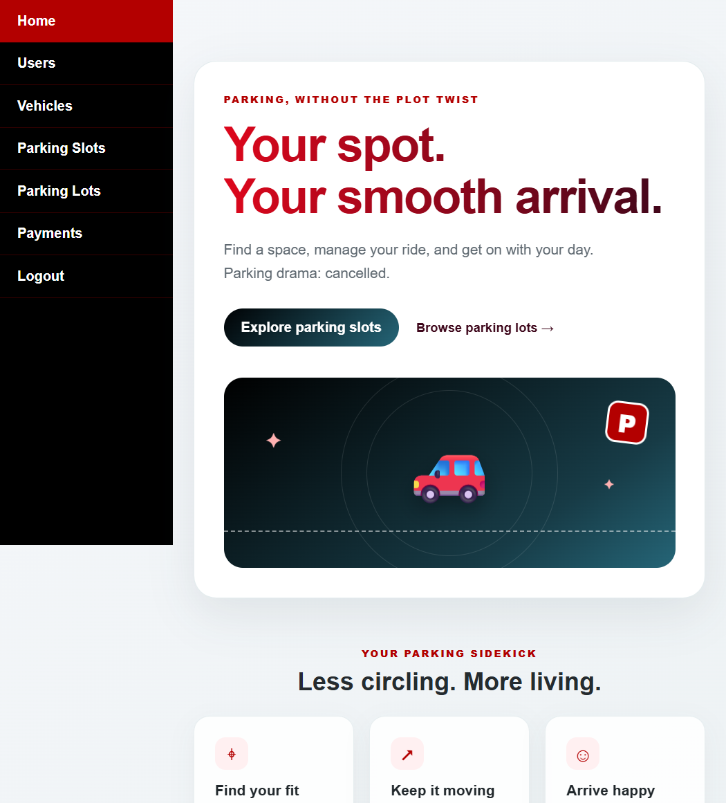
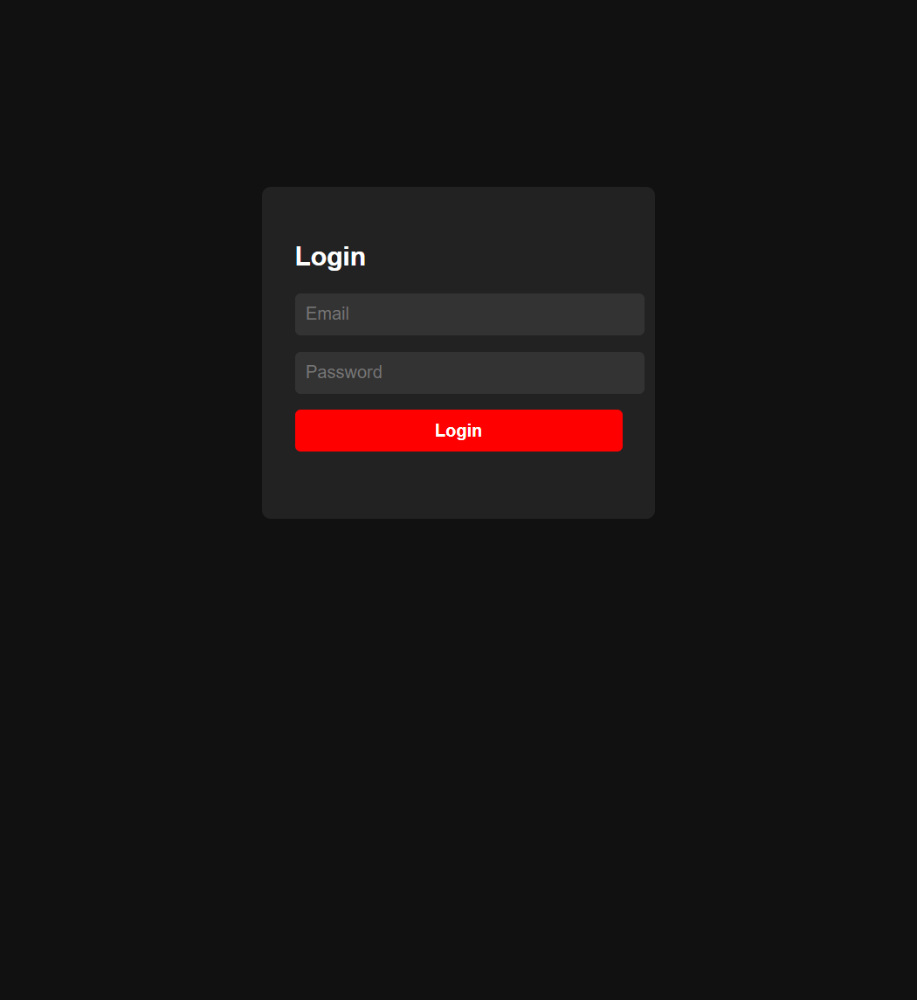

# VPMS 

Parking, minus the plot twist. VPMS is a small web app for organizing parking spaces and the people and vehicles that use them.

## What it does

- Manage users and registered vehicles.
- Organize parking lots and slots, including availability and status.
- Create reservations and record payment details.

## A peek inside

<table>
  <tr>
    <td align="center" width="50%"></td>
    <td align="center" width="50%"></td>
  </tr>
  <tr>
    <td align="center">Home</td>
    <td align="center">Login</td>
  </tr>
</table>

## Under the hood

- **Frontend:** HTML, CSS, and JavaScript
- **API:** Node.js and Express, listening on port `3000`
- **Database:** MySQL (`VPMS`); schema reference is in [`sql/db.sql`](sql/db.sql)

## Take it for a spin

For a frontend preview, serve `frontend` and open `http://localhost:8080`:

```bash
cd frontend
python -m http.server 8080
```

The data features need the API and a running MySQL database named `VPMS` on localhost. Set the database password before starting the API:

```powershell
$env:DB_PASSWORD = "your-mysql-password"
```

Then start the API in a second terminal:

```bash
cd backend
npm install
npm start
```

The frontend can be previewed without the API; pages that load or save data need both the API and database running.
